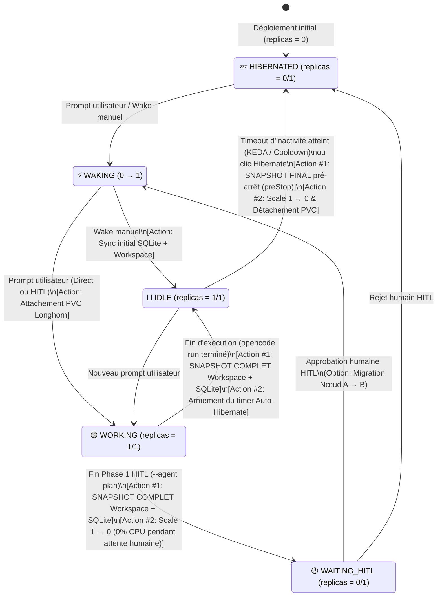

# Architecture Decision Records (ADR) — Plateforme Agentique Durable K3s + OpenCode v2 + Longhorn

Ce document consigne les décisions d'architecture structurantes prises lors de la conception et de l'évolution du laboratoire `k8s-opencode/agent-platform-lab`.

---

## ADR-001 : Isolation d'exécution « 1 Instance d'Agent = 1 Pod dédié + 1 PVC `ReadWriteOncePod` » et stratégies de multi-instanciation

- **Date** : Novembre 2026
- **Statut** : Accepté & Implémenté
- **Composants concernés** : Manifestes déclaratifs `kind: DurableAgent` (`agents/*.yaml`), Console d'orchestration (`app_chapeau/main.py`), Stockage distribué Longhorn CSI (`platform/storageclass.yaml`).

### 1. Contexte et problématique

Dans la plateforme, un agent est défini de manière déclarative via un manifeste YAML (`apiVersion: agent.platform.io/v1alpha1`, `kind: DurableAgent`) qui décrit :
- son **rôle métier** et ses instructions système (`spec.instructions` → `AGENTS.md`),
- son **modèle LLM** (`spec.model`, ex: `ollama/gpt-oss:20b-32k`),
- sa **matrice de permissions** (`spec.permissions` : `read`, `write`, `edit`, `bash`),
- sa **politique d'auto-hibernation** (`spec.scaling.idleTimeoutSeconds`, `minReplicas: 0`, `maxReplicas: 1`),
- son **volume persistant** (`spec.storage.size`, `accessMode: ReadWriteOncePod`, `storageClassName: agent-longhorn`).

Lorsqu'on souhaite exécuter plusieurs agents en parallèle — ou instancier plusieurs fois un même *template* d'agent (par exemple $N$ agents `opencode-dev-website` travaillant sur des projets distincts) — deux modèles d'architecture s'opposent :
1. **Option A (Co-localisation multi-instances dans un même Pod)** : Faire tourner plusieurs processus ou sessions d'agents distincts à l'intérieur d'un Pod Kubernetes unique partageant le même volume `/data`.
2. **Option B (Isolation stricte : 1 Instance d'Agent = 1 Pod dédié + 1 PVC dédié `ReadWriteOncePod`)** : Associer chaque instance d'agent à son propre couple `(Pod, PVC Longhorn)` isolé, géré individuellement de `0` à `1` réplique.

### 2. Analyse des options

| Critère technique | Option A : Multi-instances dans un même Pod | Option B : 1 Instance d'Agent = 1 Pod + 1 PVC (`ReadWriteOncePod`) |
|---|---|---|
| **Intégrité SQLite WAL (`/data/opencode.db`)** | ❌ Risque élevé de contention de verrous (`SQLITE_BUSY`) ou de corruption si plusieurs processus accèdent concurremment à la même base ou si le Pod est répliqué. | ✅ Un seul écrivain garanti au niveau CSI Kubernetes par `ReadWriteOncePod` (stable depuis K8s v1.29). Aucune contention SQLite. |
| **Isolation du Workspace (`/data/workspace`)** | ❌ Collisions directes sur l'arborescence de fichiers (`package.json`, `src/`, index Git, processus `bun`/`npm`). | ✅ Chaque instance possède son propre système de fichiers ext4 monté sur `/data/workspace`. |
| **Cycle de vie & Scale-to-Zero (`0 ↔ 1`)** | ❌ Impossible d'hiberner l'Agent #1 (inactif) tant que l'Agent #2 (dans le même Pod) travaille. | ✅ Chaque instance d'agent hiberne (`replicas: 0`, **0 MiB RAM**) et se réveille (`replicas: 1`) indépendamment selon son propre `idleTimeoutSeconds`. |
| **Mobilité inter-nœuds (Live Migration)** | ❌ Déplacer un agent impose de déplacer tous les agents co-localisés dans le Pod. | ✅ Un agent en pause (`waiting_hitl` ou `hibernated`) peut être migré individuellement d'un nœud K3s à l'autre (`agentlab-server` ↔ `agentlab-worker`). |
| **Sécurité & Blast Radius** | ❌ Un outil `bash` défaillant, une saturation RAM (OOMKill) ou une fuite de secrets impacte tous les agents du Pod. | ✅ Confinement par Pod (`runAsUser: 10001`, `requests/limits` CPU/RAM dédiés, `ServiceAccount` et `Secret` dédiables par agent). |

### 3. Décision

Nous retenons **l'Option B : 1 Instance d'Agent = 1 Pod dédié + 1 PVC Longhorn dédié en mode `ReadWriteOncePod`**, avec une stratégie de déploiement `strategy.type: Recreate`.

Concrètement, chaque manifeste `kind: DurableAgent` est compilé par le plan de contrôle (`_build_k8s_manifests_from_agent_yaml` dans [`app_chapeau/main.py`](../app_chapeau/main.py)) en 4 ressources Kubernetes dédiées à cette instance :
1. **`PersistentVolumeClaim` (`<agent-name>-storage`)** : Volume bloc ext4 répliqué par Longhorn (`storageClassName: agent-longhorn`) avec `accessModes: [ReadWriteOncePod]`, monté sur `/data` (`/data/opencode.db` + `/data/workspace`).
2. **`ConfigMap` (`<agent-name>-config`)** : Embarque la configuration `opencode.json` (modèle, provider, permissions *deny-by-default*) et le prompt système `AGENTS.md`.
3. **`Deployment` (`<agent-name>`)** : Gère un unique Pod (`replicas: 0` ou `1`, `strategy: Recreate`) afin de garantir qu'aucun second Pod ne démarre avant la terminaison complète et le démontage CSI de l'ancien.
4. **`ScaledObject` KEDA (`<agent-name>-scaledobject`)** : Permet l'intégration avec l'autoscaler événementiel KEDA (`minReplicaCount: 0`, `maxReplicaCount: 1`, `cooldownPeriod: <idleTimeoutSeconds>`).

### 4. Comment instancier plusieurs fois un même *template* d'agent ?

Le manifeste `kind: DurableAgent` agit comme un **modèle déclaratif**. Pour faire tourner $N$ instances d'un même profil d'agent sans jamais compromettre l'isolation **1 Agent = 1 Pod + 1 PVC**, deux patrons Kubernetes complémentaires sont retenus :

#### Patron 1 : Instances nommées par projet (Implémenté dans le Lab)
Chaque mission ou projet instancie le template YAML avec un `metadata.name` distinct (ex: `opencode-dev-website-blog`, `opencode-dev-website-landing`) :
- Chaque instance reçoit son propre Pod (`opencode-dev-website-blog-...`), son propre PVC Longhorn (`opencode-dev-website-blog-storage`), son propre cache hors-ligne (`.private/agent_cache/<name>/`) et son propre cycle d'hibernation/HITL.

#### Patron 2 : Pool indexé d'agents identiques via `StatefulSet` + `volumeClaimTemplates` (Cible Opérateur / Pool de Workers)
Lorsqu'on souhaite instancier dynamiquement une flotte de $N$ réplicas identiques d'un même template d'agent (par exemple `replicas: 3` pour dépiler une file d'attente de tickets ou d'alertes en parallèle), l'opérateur Kubernetes cible un **`StatefulSet`** muni d'un **`volumeClaimTemplates`** :

```yaml
apiVersion: apps/v1
kind: StatefulSet
metadata:
  name: opencode-dev-website
  namespace: agent-lab
spec:
  serviceName: opencode-dev-website
  replicas: 3
  podManagementPolicy: Parallel
  template:
    metadata:
      labels:
        app.kubernetes.io/name: opencode-dev-website
    spec:
      containers:
        - name: opencode
          image: ghcr.io/anomalyco/opencode:beta
          volumeMounts:
            - name: storage
              mountPath: /data
  volumeClaimTemplates:
    - metadata:
        name: storage
      spec:
        accessModes: ["ReadWriteOncePod"]
        storageClassName: agent-longhorn
        resources:
          requests:
            storage: 3Gi
```

Grâce à ce mécanisme natif Kubernetes, augmenter `replicas: 3` crée automatiquement :
- **3 Pods isolés** à identité stable : `opencode-dev-website-0`, `opencode-dev-website-1`, `opencode-dev-website-2`,
- **3 PVCs Longhorn dédiés** en `ReadWriteOncePod` : `storage-opencode-dev-website-0`, `storage-opencode-dev-website-1`, `storage-opencode-dev-website-2`.

### 5. Conséquences techniques

- **Zéro consommation RAM au repos** : Bien que chaque agent actif occupe un Pod dédié, l'auto-hibernation (`replicas: 0` après `idleTimeoutSeconds` ou pendant l'attente d'approbation humaine `waiting_hitl`) ramène l'empreinte mémoire et CPU des agents inactifs à **0 MiB / 0 mCPU**, tout en conservant leur état SQLite et leurs fichiers sur Longhorn.
- **Consultation hors-ligne (Cache d'artefacts)** : Comme le Pod et son volume `/data` sont démontés lorsque `replicas == 0`, le plan de contrôle (`app_chapeau/main.py`) synchronise avant chaque hibernation l'historique SQLite (`session`, `message`, `part`) et l'arborescence récursive `/data/workspace` dans `.private/agent_cache/<agent_name>/`. L'utilisateur peut ainsi parcourir, prévisualiser et télécharger (`.zip`) les fichiers produits même lorsque le Pod est éteint.
- **Purge à la suppression** : La suppression d'un agent via l'API (`DELETE /api/agents/{name}`) détruit conjointement le `Deployment`, le `ConfigMap`, le `PVC` Longhorn et le cache local `.private/agent_cache/<name>/` afin qu'une ré-instanciation ultérieure du même nom reparte d'un état vierge.

### 6. Références officielles

- Kubernetes Persistent Volumes & `ReadWriteOncePod` : https://kubernetes.io/docs/concepts/storage/persistent-volumes/#access-modes
- Kubernetes `StatefulSet` & `volumeClaimTemplates` : https://kubernetes.io/docs/concepts/workloads/controllers/statefulset/
- KEDA Scaling Deployments & `cooldownPeriod` (`0 ↔ 1`) : https://keda.sh/docs/2.16/concepts/scaling-deployments/
- SQLite Write-Ahead Logging (WAL) & Concurrency : https://sqlite.org/wal.html
- Longhorn CSI Volume Attachment & Replicas : https://longhorn.io/docs/

---

## ADR-002 : Synchronisation des artefacts (Snapshot Control Plane) et Machine à états du cycle de vie d'un Pod Agent

- **Date** : Novembre 2026
- **Statut** : Accepté & Implémenté
- **Composants concernés** : [`app_chapeau/main.py`](../app_chapeau/main.py) (`_sync_agent_pod_to_cache`, `_run_opencode_turn`, `_scale_agent`, `_auto_hibernate_reconciler`), Cache local `.private/agent_cache/<agent>/`.

### 1. Contexte : Pourquoi le Control Plane ne monte pas directement le PVC de l'agent ?

Le volume Longhorn (`agent-longhorn`, `numberOfReplicas: 2`) assure à lui seul la **durabilité et la haute disponibilité des données** (`/data/opencode.db` + `/data/workspace`) face à la perte d'un nœud K3s.
Cependant, l'application de supervision (« App Chapeau » / Control Plane) ne tourne pas dans le même Pod que l'agent (dans le lab, elle tourne sur l'hôte ; en cible, dans son propre Pod Kubernetes). Elle a pourtant besoin d'afficher la liste des fichiers générés, de prévisualiser un site web (`/preview/<agent>/index.html`), de télécharger une archive `.zip` et d'inspecter les sessions SQLite :
1. **Pendant que l'agent est en attente (`IDLE`, `replicas: 1`)** après avoir terminé sa tâche sans encore hiberner.
2. **Pendant que l'agent est en hibernation (`HIBERNATED` ou `WAITING_HITL`, `replicas: 0`)** alors que le périphérique bloc Longhorn est démonté (`state: detached`).

Monter le PVC de chaque agent directement dans le Pod du Control Plane a été écarté pour trois raisons techniques :
- En mode **`ReadWriteOncePod`** (ou `RWO`), garder le PVC monté dans le Control Plane empêche le Pod de l'agent de démarrer sur un autre nœud (`Multi-Attach error`).
- En mode **`ReadWriteMany` (RWX)**, Longhorn intercale un serveur NFSv4 (`share-manager` Ganesha) incompatible avec le mode **SQLite WAL** d'OpenCode (`mmap` sur `opencode.db-shm` non supporté sur NFS) et maintient un Pod NFS actif en permanence par volume, annulant le gain du *scale-to-zero*.
- Dans Kubernetes, `spec.volumes` d'un Pod est immuable : ajouter un agent imposerait de redémarrer le Pod du Control Plane.

### 2. Décision : Double mécanisme « Lecture Directe + Snapshot sur Transition d'État »

Plutôt que de partager le montage bloc, le Control Plane maintient un **miroir d'artefacts et de métadonnées** (`.private/agent_cache/<agent_name>/` dans le lab ; bucket S3/MinIO en cible de production) synchronisé lors des **transitions d'état du Pod**.

Ainsi, même si l'auto-hibernation est désactivée et que le Pod reste à l'état **`IDLE (1/1)`** après sa tâche, les données sont immédiatement disponibles dans l'App Chapeau grâce au snapshot de **fin de tour (`WORKING → IDLE`)** doublé d'une lecture directe à la demande dans le Pod.

### 3. Diagramme d'états du Pod Agent et déclencheurs d'actions



### 4. Matrice des états, accès aux données et actions déclenchées

| État de l'Agent | État du Pod K8s & Volume Longhorn | Déclencheur d'entrée dans l'état | Action de Snapshot / Synchronisation | Comment l'App Chapeau lit les fichiers & sessions ? |
|---|---|---|---|---|
| **🟢 `WORKING`** | `1/1 Running`<br>PVC `attached` | Envoi d'un prompt ou validation HITL | Flux temps réel **NDJSON** (`opencode run --format json`) poussé dans le Live Feed. *Pas de sonde SQLite concurrente pour éviter les doublons.* | Flux temps réel en mémoire + miroir du tour précédent. |
| **🔵 `IDLE`** *(Tâche finie, Pod non hiberné)* | `1/1 Running`<br>PVC `attached` | Fin du processus `opencode run` (ou arrêt manuel `Stop`) | **Snapshot Complet Immédiat (`include_file_contents=True`)** dès la sortie de `opencode run` + sonde légère de l'arborescence toutes les 6s. | **Lecture directe dans le Pod** (`kubectl exec`) **ET** copie déjà présente dans `.private/agent_cache/<agent>/workspace/`. |
| **🟡 `WAITING_HITL`** | `0/1 Terminated`<br>PVC `detached` | Fin de l'analyse en lecture seule (`--agent plan`) | **Snapshot Complet Immédiat** de la session SQLite (`session_id`) et du plan avant le `scale --replicas=0`. | Lecture 100 % depuis le **cache local** `.private/agent_cache/<agent>/` (0 MiB RAM consommés sur K3s). |
| **💤 `HIBERNATED`** | `0/1 Terminated`<br>PVC `detached` | Expiration du `idleTimeoutSeconds` (Auto-Hibernate) ou clic `Hibernate` | **Snapshot Final Pré-Arrêt** (`_scale_agent(name, 0)` / hook `preStop`) juste avant le démontage du PVC Longhorn. | Lecture 100 % depuis le **cache local** `.private/agent_cache/<agent>/` (aperçu web, copie, `.zip` et transcripts SQLite restent actifs). |

### 5. Références officielles

- Kubernetes Container Lifecycle Hooks (`preStop`) : https://kubernetes.io/docs/concepts/containers/container-lifecycle-hooks/
- Kubernetes Pod Termination Lifecycle : https://kubernetes.io/docs/concepts/workloads/pods/pod-lifecycle/#pod-termination
- Longhorn Volume Engine & Replicas (Node Failure Resilience) : https://longhorn.io/docs/latest/concepts/#2-volume-engine-and-replicas
- Longhorn RWX Volumes & NFSv4 Share Manager Limitations : https://longhorn.io/docs/latest/nodes-and-volumes/volumes/rwx-volumes/
- SQLite WAL Mode on Network Filesystems (`mmap` / `-shm`) : https://sqlite.org/wal.html#noshm
- KubeOpenCode Control Plane Architecture : https://github.com/kubeopencode/kubeopencode

---

## ADR-003 : Découplage entre la Définition de l'Agent (`DurableAgent`) et ses Déclencheurs d'Invocation (API Événementielle & `CronJob`)

- **Date** : Novembre 2026
- **Statut** : Accepté
- **Composants concernés** : Manifestes `agents/*.yaml` (`kind: DurableAgent`), API d'événements du Control Plane (`POST /api/agents/{name}/message`).

### 1. Contexte et principe de responsabilité unique (KISS)

Un agent peut être sollicité de multiples façons :
- Interaction humaine directe depuis l'App Chapeau (UI),
- Combo « Instanciation + 1er prompt » piloté par l'UI ou un orchestrateur,
- Planification périodique (ex: *Morning SRE Review* tous les matins à 08h00),
- Événement externe (Webhook Alertmanager, GitHub, CI/CD).

Intégrer les expressions `cron`, les payloads de prompts initiaux ou les règles de webhooks directement à l'intérieur du manifeste `kind: DurableAgent` mélangerait **la définition des capacités de l'agent** (son *template* / profil d'exécution) avec **l'orchestration de ses invocations** (ses *tâches* et événements).

### 2. Décision

1. **Pureté du manifeste `kind: DurableAgent` et état initial `HIBERNATED (0/1)`** :
   - Le YAML de l'agent définit exclusivement son profil d'exécution (modèle, permissions, instructions système `AGENTS.md`, stockage PVC `ReadWriteOncePod` et politique `autoHibernate`).
   - Tout agent nouvellement déclaré démarre à l'état **`HIBERNATED` (`replicas: 0`, 0 MiB RAM)** tant qu'aucun événement ne le sollicite.
2. **Invocation découplée par l'API Événementielle du Control Plane (`POST /api/agents/{name}/message`)** :
   - Le réveil (`0 → 1`) et l'exécution d'une instruction sont déclenchés de manière uniforme par un appel à l'API du Control Plane :
     - **Tâche planifiée** : Un `CronJob` Kubernetes standard (`batch/v1`) appelle l'API du Control Plane à l'échéance voulue avec le prompt métier.
     - **Événement externe** : Un récepteur de webhook (ou l'App Chapeau lors d'un combo *Déploiement + Prompt*) poste l'événement sur cette même API.
3. **Identité et Authentification des émetteurs d'événements (Cible Production)** :
   - **Émetteurs internes au cluster (`CronJob` K8s, autres microservices)** : Utilisation de jetons `ServiceAccount` projetés à durée de vie limitée et audience bornée (*Bound ServiceAccount Token Projection*, `audience: agent-control-plane`), vérifiés par le Control Plane via l'API native Kubernetes **`TokenReview` (`authentication.k8s.io/v1`)** et autorisés par RBAC (`SubjectAccessReview`).
   - **Émetteurs externes (Alertmanager, GitHub, API clientes)** : Authentification par clé d'API scopée par agent/tenant (`X-Agent-Trigger-Token`) ou vérification de signature HMAC, stockée dans un `Secret` Kubernetes géré par External Secrets Operator (ESO).

### 3. Références officielles

- Kubernetes CronJob (`batch/v1`) : https://kubernetes.io/docs/concepts/workloads/controllers/cron-jobs/
- Kubernetes Bound ServiceAccount Token Volume Projection : https://kubernetes.io/docs/tasks/configure-pod-container/configure-service-account/#serviceaccount-token-volume-projection
- Kubernetes `TokenReview` API (`authentication.k8s.io/v1`) : https://kubernetes.io/docs/reference/kubernetes-api/authentication-resources/token-review-v1/


