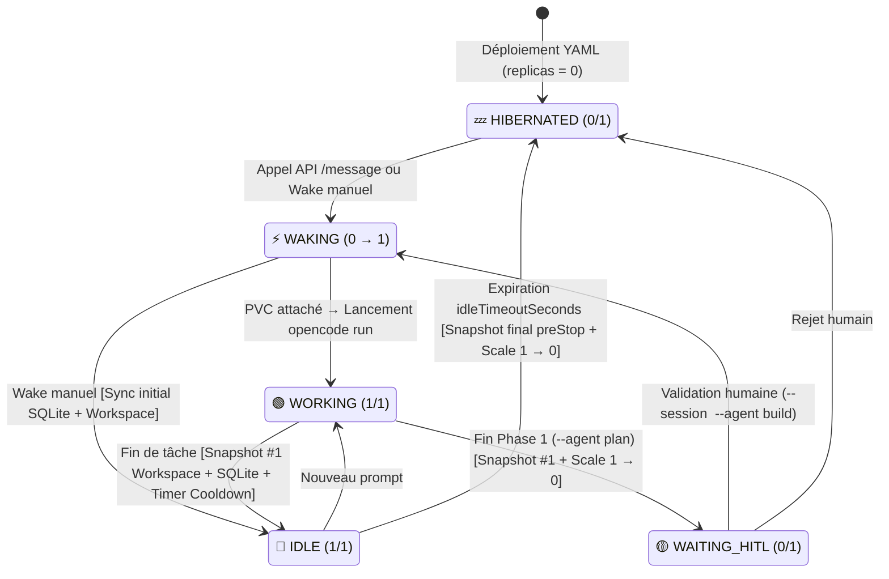

# Une plateforme d'agents IA durables sur Kubernetes en moins de 1 000 lignes de code

Après les chatbots, les harnais (*agent harnesses*) ont, en 2026, réellement fait progresser l'usage en matérialisant l'IA agentique.
Dorénavant, chaque utilisateur de l'IA dispose sur son poste d'un outil ou d'une application pour lancer plusieurs tâches en parallèle.
Cependant pour les agents, comme pour d'autres sujets auparavant dans le monde de l'entreprise, il faut pouvoir faire passer cet usage à l'échelle.
C'est ce que l'on nomme les plateformes d'« *Enterprise AI Agent* ».
Leur cahier des charges est de permettre de disposer d'un environnement agentique toujours disponible, auditable, respectant les politiques de l'entreprise et pour un coût maîtrisé.

L'offre des plateformes agentiques est en train de se structurer, avec notamment les propositions des grands fournisseurs Cloud. On peut citer *AWS Bedrock Agents* et *Google Cloud Vertex AI Agent Engine* (*Google Agent Platform*).
Mais comme toujours, il existe une alternative *Make or Buy*, et bien entendu un *Make* qui se doit de ne pas réinventer la roue.

Je vous propose ici de **construire un socle modulaire sur une infrastructure Kubernetes** en assemblant un *harnais* open-source et des briques cloud-natives standards afin de maîtriser l'hébergement des données, le cloisonnement, la boucle agentique — y compris « l'humain dans la boucle » (HITL) — et les coûts d'exécution.

Le cœur de ce socle tient en **moins de 1 000 lignes de code** (~190 lignes de manifestes Kubernetes de base, ~800 lignes de Python pour le *Control Plane*, et ~35 lignes de YAML pour déclarer un nouvel agent).
Bien entendu, ce noyau ne couvre que le moteur d'exécution et le cycle de vie. Pour constituer une plateforme d'entreprise complète, il faudra y ajouter plusieurs briques essentielles volontairement laissées hors du périmètre de ce lab :
- **Identité et délégation de droits** : restreindre les droits d'un agent en faisant du « au-nom-de » (*On-Behalf-Of*) via son identité applicative et les droits de l'utilisateur qui l'invoque.
- **Gouvernance des plugins (MCP, Skills)** : gérer le registre et la distribution des plugins (serveurs MCP, *skills*), et filtrer les appels d'outils via une passerelle (OPA/Cedar).
- **Prompt management** : versionner, tester et gouverner le cycle de vie des prompts système et métier en dehors du code d'infrastructure.
- **Passerelle LLM, FinOps et coupe-circuits** : routage multi-modèles avec bascule (via par exemple LiteLLM ou OpenRouter), garanties de confidentialité (*Zero Data Retention* / RGPD), quotas de tokens et plafonds budgétaires.
- **Observabilité et évaluation en CI** : collecte des traces d'exécution OpenTelemetry, génération de l'Agent BOM et évaluation des agents en CI avant déploiement.
- **Durcissement et bonnes pratiques Kubernetes** : cloisonnement réseau des Pods (`NetworkPolicies` et filtrage du trafic sortant), exécution sans privilèges des conteneurs, surveillance Trivy pour les déploiements, surveillance Falco pour les mouvements à l'exécution, gestion externe des secrets avec ESO, quotas de ressources, ...

---

## 1. Objectifs fonctionnels et choix techniques

### Objectifs

1. **Ne pas réinventer la roue au niveau du moteur d'exécution d'agent (*Agent Harness*)** :
   - *Objectif* : ne pas réinventer ou recoder la boucle agentique, l'accès aux outils et aux serveurs MCP, ni la gestion des permissions. Bénéficier des évolutions d'un harnais solide.

2. **Tenir la charge de plusieurs agents sans faire exploser les coûts d'infrastructure** :
   - *Objectif* : afin de supporter la charge induite par la mutualisation d'une telle plateforme sans faire exploser les coûts, nous cherchons à avoir *by-design* un mécanisme de mise en hibernation qui garantit zéro consommation CPU/RAM au repos. Cela implique aussi de pouvoir passiver la session de travail et le contenu généré, puis de restaurer l'état complet lorsqu'un événement le nécessite (demande humaine ou alerte externe, par exemple).

3. **Disposer d'une approche *as-code*** :
   - *Objectif* : pouvoir provisionner à la fois l'infrastructure et les agents sur la base d'éléments descriptifs historisables dans Git, et disposer d'une API pour piloter tout le cycle de vie des agents.

4. **Proposer un *boilerplate* capable de supporter la haute disponibilité** :
   - *Objectif* : ne pas tout coder, mais poser des bases s'appuyant sur des briques éprouvées pour assurer une vraie résilience opérationnelle et supporter la haute disponibilité.

### Choix techniques

Les choix structurants ici sont **Kubernetes** et **OpenCode v2**.

OpenCode v2 vient de sortir il y a quelques heures lorsque je lance ce travail. Depuis sa v1, c'est un harnais open-source avec une bonne adoption, de nombreuses fonctionnalités et des fondamentaux qui permettent de l'étendre.
Il a la particularité d'avoir une empreinte en ressources faible et une architecture simple : il tourne aisément dans un conteneur, nécessite un espace disque pour son *workspace* (`/data/workspace`) et une base SQLite pour stocker ses sessions (`/data/opencode.db`).

Kubernetes va permettre de mettre en œuvre :
- la maîtrise CPU/RAM via le pilotage de la taille des déploiements (`Deployment` / `ReplicaSet` entre `0` et `1` réplique),
- l'attachement de volumes persistants (`PVC`) pour le *workspace* et la base SQLite,
- la définition déclarative de « patrons » d'agents en YAML.

> **Note :** quelque temps après avoir lancé ce lab, je suis tombé sur deux projets similaires qui valident cette approche : **[KubeOpenCode](https://github.com/kubeopencode/kubeopencode)** (initialement construit sur OpenCode v1) et **[Ambient Code Platform](https://github.com/ambient-code/platform)** (qui applique ce même modèle sur Kubernetes avec le harnais *Claude Code*).

---

## 2. Implémentation

Nous avons créé une application web de type « Plan de Contrôle » (*Control Plane*). Celle-ci est dotée d'une API REST qui permet de réaliser toutes les opérations du cycle de vie, et propose une interface web de pilotage et de monitoring.

Le cycle de vie d'un agent se déroule en 7 étapes :

1. **Définition** : nos agents sont définis par un manifeste YAML `kind: DurableAgent` ([voir la section Exemples](#1-fichier-de-définition-dun-patron-dagent)).
2. **Instanciation** : ils sont instanciés par un appel API `POST /api/agents/apply` qui provisionne le `PVC`, le `ConfigMap` et le `Deployment` Kubernetes ([voir l'exemple d'appel API](#2-instancier-un-agent-par-api)).
3. **Hibernation initiale** : ils commencent leur cycle de vie dans l'état `HIBERNATED` (`replicas: 0`, 0 Mio de RAM consommée).
4. **Réveil sur événement** : s'ils reçoivent un événement (`POST /api/agents/{name}/message`, par exemple un prompt utilisateur, un webhook ou un `CronJob`), le Control Plane les réveille (`replicas: 1`) et transmet l'événement à OpenCode. Ils passent alors à l'état `WORKING`.
5. **Surveillance de l'exécution et flux NDJSON** : leur état est suivi en temps réel par le Control Plane qui consomme le flux **NDJSON** (*Newline Delimited JSON*) émis sur la sortie standard par `opencode run --format json` (chaque étape de réflexion, appel d'outil et réponse est streamée ligne par ligne dans l'UI) tout en supervisant l'état du Pod et du volume via l'API Kubernetes.
6. **Retour à l'état `IDLE` et premier Snapshot** : dès que la tâche OpenCode se termine, l'agent bascule à l'état `IDLE` (`1/1`) et un premier snapshot du *workspace* (`/data/workspace`) et de la base de données SQLite (`/data/opencode.db`) est immédiatement réalisé vers le Control Plane.
7. **Auto-hibernation (`Scale-to-Zero`)** : au bout de $X$ secondes d'inactivité (`idleTimeoutSeconds`), un snapshot final de sécurité est réalisé et un événement de *scale-down* est déclenché (exécuté dans notre lab par la boucle de réconciliation du Control Plane via `kubectl scale deploy/<agent> --replicas=0`, ou délégué en cible à un `ScaledObject` **KEDA** couplé à un hook Kubernetes `lifecycle.preStop`).

Le cycle reboucle ensuite sur l'étape 4 à chaque nouvel événement, en reprenant la même session SQLite (`--session <id>`). On peut également interrompre une tâche en cours (`POST /api/agents/{name}/stop`) ou détruire définitivement l'agent et son volume par un appel API `DELETE /api/agents/{name}` ([voir la section Exemples](#4-arrêter-une-tâche-ou-supprimer-un-agent-par-api)).

### Le choix structurant : `1 agent running = 1 Pod + 1 PVC ReadWriteOncePod`

Dans notre implémentation, nous avons retenu un choix d'isolation simple et structurant : **1 instance d'agent = 1 Pod dédié**. Cela permet :
- d'implémenter directement le lien entre le Pod et son `PVC` en mode **`ReadWriteOncePod`** (garantissant un unique écrivain au niveau Kubernetes/CSI) pour stocker le *workspace* et la base SQLite en mode WAL (`/data/workspace` et `/data/opencode.db`),
- de faciliter la migration d'un Pod d'un nœud à un autre en cas de défaillance d'un nœud ou de redimensionnement du cluster.

Afin d'assurer cette mobilité inter-nœuds des `PVC` en mode bloc, nous avons retenu le moteur de stockage distribué **Longhorn**.

### Accès aux données en hibernation et rôle du Snapshot

Pour permettre de consulter les données d'un agent via l'API et l'interface web même lorsque celui-ci est en hibernation (`replicas: 0`, volume bloc Longhorn démonté / `detached`), le Control Plane synchronise un miroir de lecture lors des transitions d'état du Pod :



> **Note :** le premier snapshot déclenché dès la transition `WORKING → IDLE` permet de gérer les cas où l'auto-hibernation est désactivée (ou pendant que le compte à rebours d'inactivité s'écoule). Si les ressources le permettent, on peut ainsi choisir de ne pas faire hiberner un agent pour conserver une réactivité immédiate tout en ayant déjà ses fichiers et sessions synchronisés dans le Control Plane.

Pendant la phase `WORKING`, la console affiche en direct le flux **NDJSON** d'OpenCode. Dès que la tâche passe en `IDLE`, `WAITING_HITL` ou `HIBERNATED`, l'application web s'appuie sur le snapshot pour permettre de :
- consulter l'intégralité de l'historique de la session SQLite (prompts, réflexions du modèle, appels d'outils),
- prévisualiser, copier ou télécharger en `.zip` les fichiers générés par l'agent dans `/data/workspace`.

---

## 3. Exemples

### 1. Fichier de définition d'un « patron » d'agent (`kind: DurableAgent`)

```yaml
apiVersion: agent.platform.io/v1alpha1
kind: DurableAgent
metadata:
  name: opencode-dev-website
  namespace: agent-lab
  role: "Création de Site Web"
spec:
  model: "ollama/gpt-oss:20b-32k"
  scaling:
    autoHibernate: true
    idleTimeoutSeconds: 180
    minReplicas: 0
    maxReplicas: 1
  storage:
    size: 2Gi
    accessMode: ReadWriteOncePod
    storageClassName: agent-longhorn
  permissions:
    read: allow
    write: allow
    edit: allow
    bash: allow
  instructions: |
    Tu es un développeur web spécialisé dans la création de sites techniques DevOps.
    Écris des fichiers complets dans /data/workspace avec l'outil write.
```

Il est tout à fait possible d'instancier plusieurs fois ce patron (soit sous forme d'instances nommées par projet avec un `metadata.name` dédié, soit sous forme d'un pool indexé via un `StatefulSet` et son `volumeClaimTemplates`).

### 2. Instancier un agent par API (`POST /api/agents/apply`)

```bash
curl -X POST http://localhost:8000/api/agents/apply \
  -H "Content-Type: application/json" \
  -d "{\"yaml_content\": $(jq -Rs . < agents/opencode-dev-website.yaml)}"
```

Cet appel crée dans Kubernetes le `PVC` Longhorn (`ReadWriteOncePod`), le `ConfigMap` (`opencode.json` + `AGENTS.md`) et le `Deployment` initialisé à `replicas: 0` (`HIBERNATED`).

### 3. Envoyer des événements à un agent (`POST /api/agents/{name}/message`)

Tout agent nouvellement déployé naît à l'état `HIBERNATED (0/1)`. Comme son Pod est éteint, il ne peut ni faire tourner un démon `cron` interne, ni écouter un port HTTP pour recevoir un webhook.

Le manifeste YAML `kind: DurableAgent` décrit uniquement ce qu'est l'agent ; son invocation est déléguée à l'API événementielle du Control Plane (`POST /api/agents/{name}/message`), qui réalise en une seule opération le réveil `0 → 1`, l'attachement du `PVC` et l'exécution du prompt (en mode direct `auto` ou avec arbitrage humain `hitl_plan`) :

```bash
curl -X POST http://localhost:8000/api/agents/opencode-sre/message \
  -H "Content-Type: application/json" \
  -d '{
    "prompt": "Vérifie l état des volumes et génère un rapport dans report.md.",
    "mode": "auto",
    "continue_session": true
  }'
```

Ce découplage permet de combiner des briques simples :
- **Déclenchement par scheduler** : un `CronJob` Kubernetes standard (`batch/v1`) appelle l'API du Control Plane aux horaires voulus. Pour sécuriser cet appel en production, le `CronJob` projette un jeton `ServiceAccount` borné dans le temps et par audience, que le Control Plane vérifie auprès de l'API native Kubernetes `TokenReview` (`authentication.k8s.io/v1`).
- **Déclenchement sur événement externe** : Alertmanager, GitHub ou un pipeline CI/CD appelle ce même endpoint muni d'une clé d'API scopée par agent.

### 4. Arrêter une tâche ou supprimer un agent par API (`stop` / `DELETE`)

```bash
# Interrompre une exécution OpenCode en cours sans supprimer l'agent :
curl -X POST http://localhost:8000/api/agents/opencode-dev-website/stop

# Supprimer définitivement l'agent, son Deployment, son PVC Longhorn et son cache :
curl -X DELETE http://localhost:8000/api/agents/opencode-dev-website
```

---

## 4. Tests et retour d'expérience

Sur un hôte Ubuntu 26.04 LTS hébergeant deux VMs K3s et Longhorn CSI (en 2 réplicas), nous avons pu valider :
- la résilience à la perte d'un nœud du cluster et la migration d'un agent d'un nœud à l'autre avec conservation de sa session SQLite,
- le workflow d'« humain dans la boucle » (HITL) en deux phases (`--agent plan` en lecture seule puis mise en hibernation à `0/1` pendant l'attente humaine, suivi de `--agent build` sur la même session après validation),
- des temps d'hibernation et de réveil tout à fait acceptables (hibernation en ~3 à 5 s, réveil avec rattachement du volume Longhorn entre 3 et 20 s selon qu'il y a changement de nœud ou non),
- la disponibilité permanente du snapshot dans le Control Plane pour l'audit des sessions SQLite, l'aperçu web et le téléchargement des livrables en `.zip`.

---

## 5. Reproduire le lab en local

L'ensemble du code, des manifestes Kubernetes et des scripts est disponible dans le dossier [`k8s-opencode/agent-platform-lab/`](https://github.com/MathFrenchToast/durable-agents-k8s/tree/main/k8s-opencode/agent-platform-lab) du dépôt.

### Périmètre et prérequis sur la machine hôte

Le lab provisionne deux machines virtuelles Ubuntu 24.04 LTS (`agentlab-server` et `agentlab-worker`) formant un cluster **K3s** à deux nœuds avec le moteur de stockage distribué **Longhorn** :
- **Système hôte** : Linux x86_64 (testé sur Ubuntu 26.04 LTS) avec virtualisation KVM active (`qemu-kvm`, `libvirt-daemon-system`, `virtinst`, `cloud-image-utils`), `kubectl`, `helm` et `python3-venv`.
- **Ressources** : 8 vCPU logiques, 16 à 24 Gio de RAM et ~40 Gio d'espace disque libre.
- **Stockage distribué Longhorn (dans les VMs)** : lors du provisionnement (`infra/provision.sh`), `cloud-init` installe et active automatiquement les démons `open-iscsi` (`iscsid`) et `nfs-common` requis par Longhorn sur chaque nœud. Le script `bootstrap/install-longhorn.sh` déploie ensuite le chart Helm officiel `longhorn/longhorn` configuré à 2 réplicas (`defaultReplicaCount=2` sur `/var/lib/longhorn`) et crée la `StorageClass` `longhorn-agent-durable` (`numberOfReplicas: "2"`, `fsType: ext4`, `reclaimPolicy: Retain`). C'est ce qui permet de tester la réplication bloc synchrone entre les deux VMs et le rattachement du `PVC` lorsqu'un agent change de nœud.
- **Fournisseur LLM** : le lab utilise par défaut une instance **Ollama** sur l'hôte (avec `qwen2.5-coder:7b` et une fenêtre de contexte portée à `32768` tokens pour supporter le prompt système et les schémas d'outils d'OpenCode v2), rendue accessible aux Pods via la passerelle `192.168.124.1:11434`. N'importe quelle API compatible OpenAI ou Anthropic peut aussi être configurée dans le YAML de l'agent.
- **Confinement sur le poste** : tous les artefacts générés (disques `.qcow2`, clés SSH éphémères, `kubeconfig`, cache Helm, `venv` Python, snapshots d'agents) sont stockés dans `k8s-opencode/agent-platform-lab/.private/` afin de ne jamais polluer le `$HOME` de l'utilisateur.

### Lancer, utiliser et nettoyer le lab

```bash
git clone https://github.com/MathFrenchToast/durable-agents-k8s.git
cd durable-agents-k8s/k8s-opencode/agent-platform-lab

# 1. Provisionner les 2 VMs, installer K3s + Longhorn, déployer l'agent initial
#    et démarrer le Control Plane web (sur http://localhost:8000 ou le 1er port libre) :
./up.sh

# 2. Relancer uniquement la console web du Control Plane si besoin :
./start-ui.sh

# 3. Exécuter les scripts de test en ligne de commande (réveil, tâche, migration de nœud, hibernation) :
./tests/wake.sh
./tests/run-coding-task.sh
./tests/migrate.sh
./tests/hibernate.sh

# 4. Mettre les VMs en pause (RAM figée, 0 % CPU) ou les reprendre en 2 secondes :
./pause.sh
./resume.sh

# 5. Détruire les VMs, le réseau libvirt et purger le dossier .private/ :
./down.sh
```

---

## 6. Références & Glossaire

### Références

- **OpenCode v2 Documentation & CLI** : [https://opencode.ai/v2/docs/](https://opencode.ai/v2/docs/)
- **Kubernetes Persistent Volume Access Modes (`ReadWriteOncePod`)** : [https://kubernetes.io/docs/concepts/storage/persistent-volumes/#access-modes](https://kubernetes.io/docs/concepts/storage/persistent-volumes/#access-modes)
- **Kubernetes StatefulSets & `volumeClaimTemplates`** : [https://kubernetes.io/docs/concepts/workloads/controllers/statefulset/](https://kubernetes.io/docs/concepts/workloads/controllers/statefulset/)
- **Kubernetes Container Lifecycle Hooks (`preStop`)** : [https://kubernetes.io/docs/concepts/containers/container-lifecycle-hooks/](https://kubernetes.io/docs/concepts/containers/container-lifecycle-hooks/)
- **Kubernetes `TokenReview` API (`authentication.k8s.io/v1`)** : [https://kubernetes.io/docs/reference/kubernetes-api/authentication-resources/token-review-v1/](https://kubernetes.io/docs/reference/kubernetes-api/authentication-resources/token-review-v1/)
- **Longhorn Volume Engine & Replicas** : [https://longhorn.io/docs/latest/concepts/#2-volume-engine-and-replicas](https://longhorn.io/docs/latest/concepts/#2-volume-engine-and-replicas)
- **Longhorn RWX Volumes & Share Manager** : [https://longhorn.io/docs/latest/nodes-and-volumes/volumes/rwx-volumes/](https://longhorn.io/docs/latest/nodes-and-volumes/volumes/rwx-volumes/)
- **KEDA Scaling Deployments (`0 ↔ 1`)** : [https://keda.sh/docs/2.16/concepts/scaling-deployments/](https://keda.sh/docs/2.16/concepts/scaling-deployments/)
- **SQLite Write-Ahead Logging (WAL)** : [https://sqlite.org/wal.html](https://sqlite.org/wal.html)
- **KubeOpenCode (OpenCode sur Kubernetes)** : [https://github.com/kubeopencode/kubeopencode](https://github.com/kubeopencode/kubeopencode)
- **Ambient Code Platform (Claude Code sur Kubernetes avec HITL)** : [https://github.com/ambient-code/platform](https://github.com/ambient-code/platform)

### Glossaire

- **CSI (*Container Storage Interface*)** : Standard permettant à Kubernetes d'attacher et de monter des volumes de stockage fournis par des moteurs tiers comme Longhorn.
- **HITL (*Human-in-the-Loop*)** : Mode d'exécution dans lequel l'agent suspend son travail après une phase d'analyse et attend la validation d'un opérateur humain avant d'appliquer des modifications.
- **KEDA (*Kubernetes Event-driven Autoscaling*)** : Composant CNCF faisant varier le nombre de Pods d'un déploiement entre `0` et `N` à partir de métriques externes ou de files d'événements.
- **MCP (*Model Context Protocol*)** : Protocole standardisant la connexion d'un modèle de langage à des outils et sources de données externes.
- **NDJSON (*Newline Delimited JSON*)** : Format de flux où chaque ligne est un objet JSON indépendant, utilisé par `opencode run --format json` pour diffuser ses événements en temps réel.
- **PVC (*PersistentVolumeClaim*)** : Ressource Kubernetes par laquelle un Pod demande un volume de stockage persistant d'une taille et d'un mode d'accès donnés.
- **RWOP (*ReadWriteOncePod*)** : Mode d'accès Kubernetes (stable depuis la v1.29) garantissant qu'un volume persistant ne peut être monté que par un seul Pod sur l'ensemble du cluster.
- **WAL (*Write-Ahead Logging*)** : Mode de journalisation de SQLite utilisant un fichier d'index en mémoire partagée (`-shm`), conçu pour les disques bloc locaux et incompatible avec les systèmes de fichiers réseau comme NFS.
